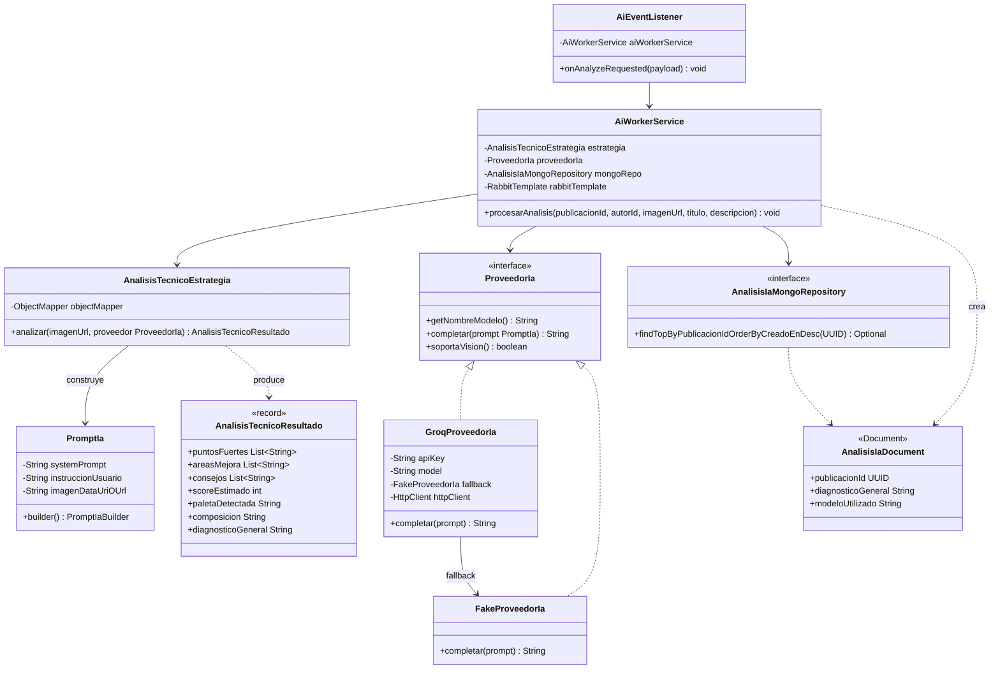

# artagram-ai-worker

Worker asíncrono de Inteligencia Artificial y Visión Multimodal para ArtaGram.

## Tecnologías
- Java 21, Spring Boot 3.3.4
- Spring Data MongoDB (base de datos `db_ia`, colecciones `analisis_ia_cache`)
- Spring AMQP (RabbitMQ cola `ai.ai.analyze` -> evento `ai.completed`)
- Cliente HTTP nativo para visión multimodal hacia Groq Cloud API (`qwen/qwen3.8-27b`)
- `FakeProveedorIa` determinista como fallback si no hay API Key configurada

## Variables de Entorno
Ver `.env.example`.

## Diseño y Arquitectura

Worker sin estado: consume `ai.analyze` de RabbitMQ, llama al proveedor de IA,
persiste el resultado en `db_ia` (Mongo) y publica `ai.completed`. Sin
superficie HTTP propia (solo Actuator).

### Principios SOLID

- **SRP** — bien separado: `AiEventListener` solo decodifica el mensaje AMQP,
  `AiWorkerService` orquesta (llama estrategia, persiste, publica evento),
  `AnalisisTecnicoEstrategia` solo construye el prompt y parsea la respuesta.
  Cada clase cambia por una sola razón.
- **OCP** — la interfaz `ProveedorIa` es el punto de extensión correcto:
  `AiWorkerService`/`AnalisisTecnicoEstrategia` dependen de la interfaz, no de
  `GroqProveedorIa` ni `FakeProveedorIa` directamente. Agregar un tercer
  proveedor (p. ej. OpenAI) es implementar `ProveedorIa` y registrarlo como
  `@Component`, sin tocar el resto del sistema.
- **OCP — violación puntual real**: `GroqProveedorIa` inyecta
  `FakeProveedorIa fallback` como **clase concreta**, no como `ProveedorIa`.
  El fallback-en-error queda hardcodeado a esa implementación específica; si
  se quisiera un fallback distinto (otro proveedor, o ninguno), hay que tocar
  `GroqProveedorIa`. Corrección de una línea: tipar el campo como `ProveedorIa`
  e inyectar con `@Qualifier`.
- **Selección de proveedor no es realmente Strategy en runtime**: hay un
  `LLM_PROVIDER` env var definido en `compose.services.yml`, pero **ningún
  código lo lee** — `GroqProveedorIa` es `@Primary` siempre, y decide
  internamente si usar la API real o el fallback según si `apiKey` está en
  blanco. Es un `LLM_PROVIDER` fantasma: documentado en infra pero sin efecto.
  Si la intención es que el operador elija el proveedor por env var, falta un
  `@ConditionalOnProperty` o una factory que lea `LLM_PROVIDER` y decida cuál
  bean de `ProveedorIa` marcar como `@Primary`.
- **LSP** — ambas implementaciones de `ProveedorIa` son sustituibles sin
  sorpresas: mismo contrato, mismas precondiciones.
- **ISP** — `ProveedorIa` tiene 3 métodos cohesivos, ninguno innecesario para
  sus implementadores.
- **DIP** — correcto en el 95%: todo depende de `ProveedorIa` como interfaz
  excepto el caso del fallback interno ya señalado.

### Extensibilidad

Agregar `OpenAiProveedorIa`: implementar `ProveedorIa`, anotarlo `@Component`
(sin `@Primary`), y resolver cuál usar mediante un `@Qualifier` o una factory
condicionada por `LLM_PROVIDER` — hoy tocaría además quitar `@Primary` de
`GroqProveedorIa` y centralizar la decisión en un solo lugar en vez de
dejarla implícita en cuál bean trae la anotación.

### Preparación para AWS

- **Sin estado, 100% worker** — buen candidato a ECS Fargate o Lambda con
  trigger de SQS si se migra el exchange de eventos (ver abajo); escala
  horizontalmente por profundidad de cola sin coordinación entre réplicas.
- **`db_ia` (Mongo)** → Amazon DocumentDB (compatible con el driver de Spring
  Data MongoDB tal cual) o MongoDB Atlas; solo cambia `SPRING_DATA_MONGODB_URI`.
- **`GROQ_API_KEY`** → AWS Secrets Manager o Parameter Store (SecureString),
  nunca en variables de entorno planas del task definition. Inyectar como
  secret de ECS task definition.
- **RabbitMQ** → Amazon MQ (RabbitMQ gestionado) es el cambio más directo
  (solo credenciales/host); si se evalúa SNS/SQS en el futuro, el único punto
  de cambio real es `AiRabbitMqConfig`/`AiEventListener`, ya aislado del resto.
- **Auto-scaling** recomendado por `ApproximateNumberOfMessagesVisible` de la
  cola (CloudWatch) en vez de CPU/memoria, dado que la carga es por evento.
- **Timeouts del cliente HTTP a Groq** (10s conexión / 30s total) ya son
  razonables para un entorno con latencia variable como AWS→API externa; no
  requieren ajuste.
