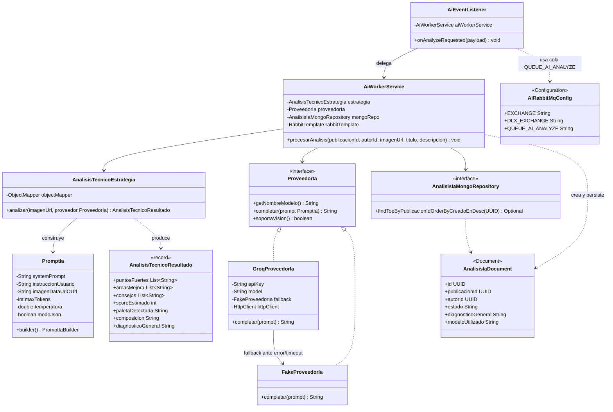

# artagram-ai-worker

Worker asíncrono de Inteligencia Artificial y Visión Multimodal para ArtaGram.

## Tecnologías
- Java 21, Spring Boot 3.3.4
- Spring Data MongoDB (base de datos `db_ia`, colecciones `analisis_ia_cache`)
- Spring AMQP (RabbitMQ cola `ai.ai.analyze` -> evento `ai.completed`)
- Cliente HTTP nativo para visión multimodal hacia Groq Cloud API (`qwen/qwen3.8-27b`)
- `FakeProveedorIa` determinista como fallback si no hay API Key configurada

## Variables de Entorno
Ver `.env.example`.

## Diseño y Arquitectura

Worker sin estado: consume `ai.analyze` de RabbitMQ, llama al proveedor de IA,
persiste el resultado en `db_ia` (Mongo) y publica `ai.completed`. Sin
superficie HTTP propia (solo Actuator).

### Principios SOLID

- **SRP** — bien separado: `AiEventListener` solo decodifica el mensaje AMQP,
  `AiWorkerService` orquesta (llama estrategia, persiste, publica evento),
  `AnalisisTecnicoEstrategia` solo construye el prompt y parsea la respuesta.
  Cada clase cambia por una sola razón.
- **OCP** — la interfaz `ProveedorIa` es el punto de extensión correcto:
  `AiWorkerService`/`AnalisisTecnicoEstrategia` dependen de la interfaz, no de
  `GroqProveedorIa` ni `FakeProveedorIa` directamente. Agregar un tercer
  proveedor (p. ej. OpenAI) es implementar `ProveedorIa` y registrarlo como
  `@Component`, sin tocar el resto del sistema.
- **OCP — violación puntual real**: `GroqProveedorIa` inyecta
  `FakeProveedorIa fallback` como **clase concreta**, no como `ProveedorIa`.
  El fallback-en-error queda hardcodeado a esa implementación específica; si
  se quisiera un fallback distinto (otro proveedor, o ninguno), hay que tocar
  `GroqProveedorIa`. Corrección de una línea: tipar el campo como `ProveedorIa`
  e inyectar con `@Qualifier`.
- **Selección de proveedor no es realmente Strategy en runtime**: hay un
  `LLM_PROVIDER` env var definido en `compose.services.yml`, pero **ningún
  código lo lee** — `GroqProveedorIa` es `@Primary` siempre, y decide
  internamente si usar la API real o el fallback según si `apiKey` está en
  blanco. Es un `LLM_PROVIDER` fantasma: documentado en infra pero sin efecto.
  Si la intención es que el operador elija el proveedor por env var, falta un
  `@ConditionalOnProperty` o una factory que lea `LLM_PROVIDER` y decida cuál
  bean de `ProveedorIa` marcar como `@Primary`.
- **LSP** — ambas implementaciones de `ProveedorIa` son sustituibles sin
  sorpresas: mismo contrato, mismas precondiciones.
- **ISP** — `ProveedorIa` tiene 3 métodos cohesivos, ninguno innecesario para
  sus implementadores.
- **DIP** — correcto en el 95%: todo depende de `ProveedorIa` como interfaz
  excepto el caso del fallback interno ya señalado.

### Extensibilidad

Agregar `OpenAiProveedorIa`: implementar `ProveedorIa`, anotarlo `@Component`
(sin `@Primary`), y resolver cuál usar mediante un `@Qualifier` o una factory
condicionada por `LLM_PROVIDER` — hoy tocaría además quitar `@Primary` de
`GroqProveedorIa` y centralizar la decisión en un solo lugar en vez de
dejarla implícita en cuál bean trae la anotación.

### Preparación para AWS

- **Sin estado, 100% worker** — buen candidato a ECS Fargate o Lambda con
  trigger de SQS si se migra el exchange de eventos (ver abajo); escala
  horizontalmente por profundidad de cola sin coordinación entre réplicas.
- **`db_ia` (Mongo)** → Amazon DocumentDB (compatible con el driver de Spring
  Data MongoDB tal cual) o MongoDB Atlas; solo cambia `SPRING_DATA_MONGODB_URI`.
- **`GROQ_API_KEY`** → AWS Secrets Manager o Parameter Store (SecureString),
  nunca en variables de entorno planas del task definition. Inyectar como
  secret de ECS task definition.
- **RabbitMQ** → Amazon MQ (RabbitMQ gestionado) es el cambio más directo
  (solo credenciales/host); si se evalúa SNS/SQS en el futuro, el único punto
  de cambio real es `AiRabbitMqConfig`/`AiEventListener`, ya aislado del resto.
- **Auto-scaling** recomendado por `ApproximateNumberOfMessagesVisible` de la
  cola (CloudWatch) en vez de CPU/memoria, dado que la carga es por evento.
- **Timeouts del cliente HTTP a Groq** (10s conexión / 30s total) ya son
  razonables para un entorno con latencia variable como AWS→API externa; no
  requieren ajuste.

## Descripción del servicio

`artagram-ai-worker` es un microservicio worker, sin superficie HTTP propia
(salvo Actuator), que se encarga de generar una crítica técnica automática de
cada obra publicada en Artagram usando un modelo de lenguaje multimodal
(visión + texto) servido por Groq Cloud. Cuando un usuario publica una obra,
otro servicio emite el evento `ai.analyze` a RabbitMQ; este worker lo consume,
envía la imagen y un prompt pedagógico al LLM, recibe un diagnóstico
estructurado (fortalezas, áreas de mejora, consejos, paleta de color,
composición y un puntaje estimado), lo persiste en MongoDB y notifica al
resto del sistema publicando `ai.completed`. Existe como worker asíncrono
separado — y no como parte del flujo síncrono de creación de publicaciones —
precisamente porque depende de una API de terceros (Groq) cuya latencia y
disponibilidad son impredecibles: un timeout, una caída o un rate limit del
proveedor externo no debe nunca bloquear ni degradar la experiencia del
usuario al publicar su obra. Al desacoplar esta llamada mediante una cola de
mensajes, el análisis de IA se resuelve "en segundo plano" y el resto del
sistema sigue funcionando con normalidad incluso si Groq está lento o fuera
de servicio.

## Responsabilidades

- Consumir el evento `ai.analyze` desde la cola durable `ai.ai.analyze`,
  enlazada al exchange `artagram.events` (`AiEventListener`, `AiRabbitMqConfig`).
- Construir el prompt multimodal (texto + imagen, vía URL o data URI en
  base64) con las instrucciones de crítica artística y el formato JSON de
  salida esperado (`AnalisisTecnicoEstrategia`, `PromptIa`).
- Invocar la API de Groq Cloud (`/openai/v1/chat/completions`, modelo
  configurable por `GROQ_MODEL`, por defecto `qwen/qwen3.8-27b`) y manejar sus
  fallos — errores HTTP, timeouts de conexión (10s) o de request (30s),
  excepciones de red — degradando automáticamente a un proveedor local
  determinista (`FakeProveedorIa`) en vez de interrumpir el procesamiento
  (`GroqProveedorIa`).
- Deserializar la respuesta del LLM a un resultado estructurado
  (`AnalisisTecnicoResultado`) y, si la respuesta no es un JSON válido o no
  cumple el esquema esperado, producir un resultado de respaldo por defecto
  en lugar de fallar la operación.
- Persistir cada análisis (diagnóstico general, paleta detectada,
  composición, puntos de mejora, sugerencias, score, modelo utilizado y
  respuesta cruda del proveedor) como documento en la colección
  `analisis_ia_cache` de la base `db_ia` en MongoDB (`AnalisisIaDocument`,
  `AnalisisIaMongoRepository`).
- Publicar el evento `ai.completed` al exchange `artagram.events` para que
  otros servicios se enteren de que el análisis de IA terminó
  (`AiWorkerService`, vía `RabbitTemplate`).
- Registrar en logs cualquier error durante el procesamiento del evento sin
  re-lanzarlo, para que un fallo de negocio no detenga el consumo de la cola.

## Diagrama de clases

## Atributos de calidad

### 1. Disponibilidad / Resiliencia ante la dependencia externa (Groq)

Este es el atributo central del servicio: toda la lógica de negocio depende
de una API de terceros cuya disponibilidad y latencia el equipo no controla.

- **Fuente**: La API externa de Groq Cloud (proveedor de LLM).
- **Estímulo**: Groq responde con un error HTTP (código ≥ 400), supera el
  timeout de conexión (10s) o de request total (30s), o lanza una excepción
  de red (caída del servicio, DNS, rate limit, etc.).
- **Artefacto**: `GroqProveedorIa.completar(PromptIa)`.
- **Ambiente**: Operación normal en producción, con `GROQ_API_KEY`
  configurada y tráfico real de publicaciones.
- **Respuesta**: El fallo se captura (bloque `catch` o verificación de
  `statusCode >= 400`), se registra en logs como advertencia/error, y el
  sistema degrada automáticamente invocando a `FakeProveedorIa`, que devuelve
  una respuesta determinista en el mismo formato esperado por
  `AnalisisTecnicoEstrategia`. No hay reintentos contra Groq: la degradación
  es inmediata, en el mismo hilo del listener.
- **Medida de respuesta**: El 100% de los eventos `ai.analyze` consumidos
  terminan en una publicación `ai.completed` y un documento persistido en
  `analisis_ia_cache`, independientemente de si Groq respondió o no; el
  tiempo total de degradación nunca excede el timeout configurado (10s de
  conexión + hasta 30s de request), tras lo cual el fallback resuelve en
  milisegundos.

### 2. Escalabilidad por profundidad de cola

- **Fuente**: Picos de publicaciones de obras de arte creadas por los
  usuarios de Artagram.
- **Estímulo**: El número de mensajes pendientes en la cola durable
  `ai.ai.analyze` crece por encima de la capacidad de procesamiento de la
  instancia actual del worker.
- **Artefacto**: La cola RabbitMQ `ai.ai.analyze` y los consumidores
  `AiEventListener` que la escuchan.
- **Ambiente**: Producción, bajo carga variable (ráfagas de publicaciones).
- **Respuesta**: El worker es completamente *stateless* entre eventos (no
  guarda contexto entre invocaciones de `procesarAnalisis`), por lo que
  pueden desplegarse réplicas adicionales que consuman de la misma cola sin
  coordinación entre ellas; RabbitMQ reparte los mensajes entre los
  consumidores activos.
- **Medida de respuesta**: El lag de la cola (mensajes visibles) puede
  mantenerse acotado agregando instancias en proporción al métrico
  `ApproximateNumberOfMessagesVisible`, sin ningún cambio de código ni de
  configuración distinta entre réplicas.

### 3. Confiabilidad / tolerancia a fallos en el pipeline de análisis

- **Fuente**: La respuesta cruda devuelta por el proveedor de IA (Groq o su
  fallback), que es texto libre generado por un modelo no determinista.
- **Estímulo**: La respuesta no es un JSON válido, o no cumple la estructura
  esperada por `AnalisisTecnicoResultado`, y `ObjectMapper.readValue` lanza
  una excepción al deserializarla.
- **Artefacto**: `AnalisisTecnicoEstrategia.analizar(...)`.
- **Ambiente**: Producción, ante cualquier respuesta impredecible de un LLM
  externo (alucinación de formato, truncamiento por `max_tokens`, etc.).
- **Respuesta**: La excepción se captura, se loggea junto con el JSON crudo
  recibido, y se retorna un `AnalisisTecnicoResultado` de respaldo con
  valores por defecto en lugar de propagar la excepción hacia arriba. Así,
  `AiWorkerService` siempre recibe un resultado válido, guarda el documento en
  Mongo y publica `ai.completed`.
- **Medida de respuesta**: Un fallo de parseo de la respuesta del LLM nunca
  provoca la pérdida del mensaje ni un documento sin persistir — el evento se
  procesa igual, aunque con un diagnóstico genérico. **Nota sobre un límite
  real de esta estrategia**: la cola `ai.ai.analyze` sí está configurada con
  dead-letter exchange (`artagram.dlx`), pero `AiEventListener` captura
  *cualquier* excepción de negocio (por ejemplo, un `publicacionId` con UUID
  inválido) dentro de su propio `try/catch` y solo la registra en el log sin
  relanzarla; por lo tanto esas excepciones nunca llegan al contenedor de
  RabbitMQ y la DLQ configurada no se activa para ese tipo de fallos — el
  mensaje se da por consumido (ack) aunque el análisis no se haya completado.
